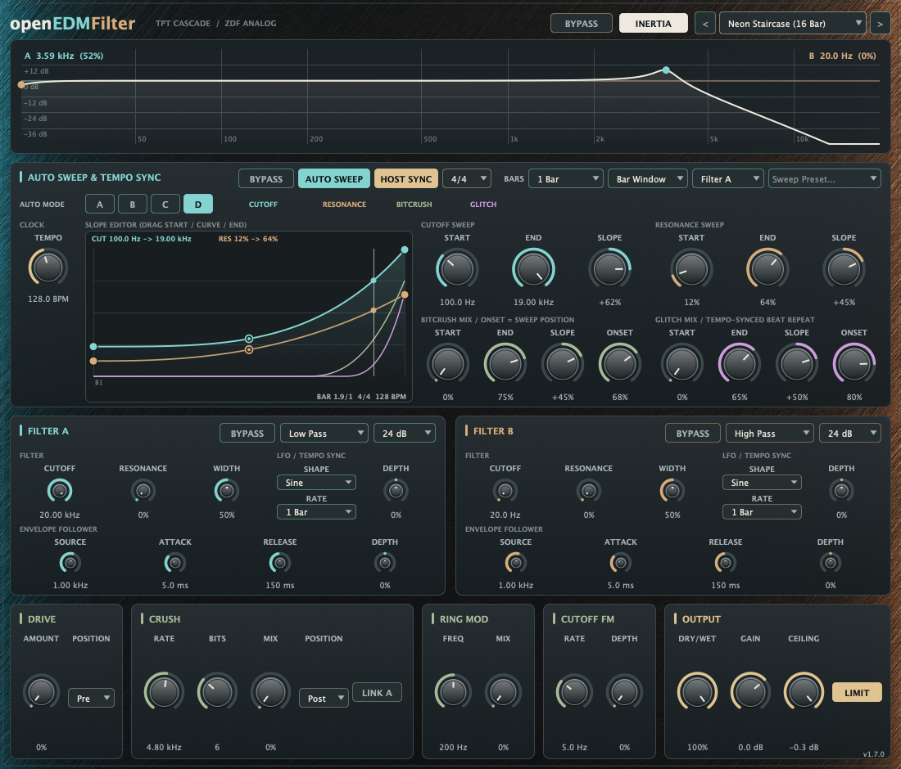

# openEDMFilter

[Install with OpenVST Manager](https://github.com/alanmarcero/alan-m-OpenVSTManager/releases/latest)

A dual multimode filter plugin for EDM production. It provides two serial filters, four automatable auto-sweep slots with independent cutoff, resonance, bitcrush and glitch curves, LFO and envelope modulation, distortion and output limiting. Release packages contain VST3, LV2 and a standalone app on macOS, Windows and Linux; macOS also includes AU.



*Captured from the native editor. [Capture details and provenance](docs/SCREENSHOTS.md).*

## Features

- Two filters in series (A into B). Each one has low-pass, high-pass, band-pass and notch modes, 12, 24, 48 or 96 dB/oct slopes, resonance, and resonance width. Width also sets the band for band-pass and notch.
- Full bypass per filter. The BYPASS button crossfades over 10 ms so it does not click. A fully bypassed filter does no processing, and its curve leaves the display.
- **Tempo / Clock Sync & Time Signature engine**. Lock to the host DAW transport (`HOST SYNC`) or run on the internal clock (`40–240 BPM`) across any time signature (`4/4`, `3/4`, `2/4`, `5/4`, `6/4`, `6/8`, `7/8`, `9/8`, `12/8`, or automatic host time signature).
- **1, 2, 4, 8, 16, 32, and 64 Bar Auto-Cutoff & Auto-Resonance Sweep**. The **BARS** selector sets the loop length. Cutoff and resonance follow that timeframe (`Bar Window`, `Every Bar`, `Up & Down`, or `Bar + Macro`) on Filter A, Filter B, Both A+B, or A/B Mirror, for every filter type and slope. The default is still 8 bars.
- **A/B/C/D Auto Mode**. Switch between four independent sweep slots using the panel buttons or the host’s `Auto Mode` automation lane. Each slot stores its own length, target, playback mode and curves. Slot A retains the original parameter IDs for older sessions.
- **Bitcrush and Glitch Sweeps**. Each slot has separate `Start`, `End`, `Slope` and `Onset` controls for both effect mixes. The graph shows all four curves. Glitch repeats the first sixteenth-note slice of each beat, with short fades at slice boundaries; very slow tempos use shorter synced subdivisions to fit the history buffer. Sweep bypass removes both automatic effects while preserving the manual crusher.
- **Interactive Slope Editor**. Drag the start, curve midpoint, and end handles directly on the multi-bar graph (or use the dedicated Cutoff and Resonance `Start`, `End`, and `Slope` knobs) to shape exponential risers, logarithmic drops, and linear sweeps in real time. Double-click a midpoint handle to reset its curvature to linear.
- **EDM Sweep Presets**. Includes factory presets and quick in-panel slope presets for EDM low-pass, high-pass, band-pass, and notch sweep ups, sweep downs, acid bar pumps, and 32/64-bar builds.
- Tempo-synced LFO per filter. Five shapes (sine, triangle, saw up, saw down, square), rates from 1/32 to 8 bars with triplets, and bipolar depth. While the host plays, the phase locks to the host transport, so the LFO lands on the same point of the bar on every pass.
- Envelope follower per filter. It has a source frequency (it listens to a band of the input), attack, release, and bipolar depth.
- Cutoff FM. A sine oscillator modulates both cutoffs, up to audio rate.
- Drive. tanh saturation, before or after the filters.
- Crush. A sample-rate reducer and bit crusher, before or after the filters. LINK A makes the crush rate follow filter A's cutoff modulation.
- Ring modulator with frequency and mix controls.
- Output section. Dry/wet, gain, and a stereo-linked lookahead peak limiter with a ceiling.
- Filter inertia. This smooths cutoff moves on 48 and 96 dB slopes to stop clicks. Turn it off for faster, harder gating.
- 34 factory presets, available from the preset menu and as host programs, plus 12 quick sweep presets in the Auto-Sweep panel.
- Live response display. It shows both curves and the combined curve, and follows the Auto-Sweep, LFO, envelope and FM in real time. Drag a band's marker to set its cutoff (left and right) and resonance (up and down).
- 2x oversampling. Everything before the limiter runs at twice the host rate, so drive, ring mod and fast FM alias less. The plugin reports 110 samples of latency (47 for the oversampler, 63 for the limiter lookahead), so hosts compensate for it.
- All parameters can be automated in the host.

VST2 and AAX are not built by this project.

## Auto mode and late-sweep effects

Turn on **AUTO SWEEP**, select **A**, **B**, **C** or **D**, and edit that slot’s curves. The **BARS** menu sets that slot to **1 Bar**, **2 Bars**, **4 Bars**, **8 Bars**, **16 Bars**, **32 Bars** or **64 Bars**. Automate **Auto Mode** or **Sweep Bars** in the host.

With host sync on, playback locks the sweep to the current tempo and time signature. Phase advances sample by sample from the block-start playhead. A stopped host holds the sweep on that playhead. Sync off, or a host with no playhead, uses the internal clock. One bar is the quarter-note length of the active signature (four quarters in 4/4). The 4/4 menu entry follows the host signature when the host provides one. Sessions saved before the 1-bar and 2-bar choices keep their original 4, 8, 16, 32 or 64 bar length, and the default is still 8 bars.

Cutoff, resonance and effect mix changes are smoothed. All four slots are saved with the session; loading an older session restores its original sweep in A with automatic effects off.

For a clean opening and a textured finish, keep the effect **Start** at 0%, set **Onset** to 75% or later, then raise **End** and adjust **Slope**. Onset is a position within the sweep trajectory: `Every Bar` repeats it each bar, and `Up & Down` retraces it on the return. Bitcrush uses the main **Crush Rate**, **Bits** and **Position** controls; its sweep mix blends on top of the manual mix. Glitch follows the host or internal clock. The quick preset menu changes the selected slot.

Four new factory presets include increasingly intense A–D variations:

- **Silk to Static (8 Bar)**: an opening low-pass with subtle late texture and a small glitch finish.
- **Neon Staircase (16 Bar)**: a longer rising sweep with six-bit crunch and stutter near the end.
- **Last Bar Breakdown (8 Bar)**: a descending sweep that adds both effects in the final bar.
- **Mainstage Fracture (32 Bar)**: a high-pass build ending in four-bit crunch and beat repeats.

## Install

1. Download and install [OpenVST Manager](https://github.com/alanmarcero/alan-m-OpenVSTManager/releases/latest) for macOS or Windows.
2. Open the manager and refresh the catalog.
3. Choose **openEDMFilter**, select **VST3** (or **AU** on macOS), and install.
4. Rescan plugins in your DAW. If you chose a custom install folder, add it to the DAW's search paths.

The source version is 1.4.0. Published release packages are still [v1.3.0](https://github.com/alanmarcero/openEDMFilter/releases/tag/v1.3.0) until the next tag. For manual installation, download your platform ZIP from that release. The macOS package is universal (Apple Silicon/Intel), with a macOS 11 deployment target. Windows and Linux packages are x64.

| Format | macOS | Windows | Linux |
| --- | --- | --- | --- |
| VST3 | `~/Library/Audio/Plug-Ins/VST3/` | `C:\Program Files\Common Files\VST3\` | `~/.vst3/` |
| AU | `~/Library/Audio/Plug-Ins/Components/` | — | — |
| LV2 | `~/Library/Audio/Plug-Ins/LV2/` | Your host's LV2 search folder | `~/.lv2/` |

Extract and copy the entire bundle to the appropriate folder, then rescan your host. OpenVST Manager installs VST3/AU; install LV2 and run the included standalone app manually. Standalone mode uses its own clock because there is no DAW transport.

## Build

You need CMake 3.22+, Git and a C++20 compiler (Xcode command-line tools on macOS, Visual Studio 2022 C++ tools on Windows, or GCC/Clang on Linux). CMake fetches JUCE 8.0.9 and Catch2 3.9.1. Linux also needs ALSA/JACK, FreeType/fontconfig, X11 and OpenGL development packages; the exact Ubuntu package list is in `.github/workflows/build.yml`.

```sh
cmake -S . -B build -DCMAKE_BUILD_TYPE=Release
cmake --build build --config Release --parallel
ctest --test-dir build -C Release --output-on-failure
```

The plugins are written to `build/OpenEDMFilter_artefacts/Release/`. Add `-DCMAKE_OSX_ARCHITECTURES="arm64;x86_64" -DCMAKE_OSX_DEPLOYMENT_TARGET=11.0` for a universal macOS build, or `-A x64` with the Visual Studio generator on Windows.

## CI

`.github/workflows/build.yml` builds and tests on macOS (universal binary), Windows and Linux on code pushes to `main` and pull requests. It runs pluginval at strictness 5 on macOS and Windows, then uploads a zip for each OS. Push a `v*` tag to publish those zips as a GitHub release.

The macOS builds have an ad hoc signature only. On first use, run `xattr -dr com.apple.quarantine <plugin>` or allow the plugin in System Settings.

## Layout

- `Source/Core`: DSP with no JUCE dependency (filters, modulators, effects, and the engine that chains them). The unit tests cover this code.
- `Source/Plugin`: the JUCE processor, parameters, presets, and editor.
- `Tests`: Catch2 tests.
