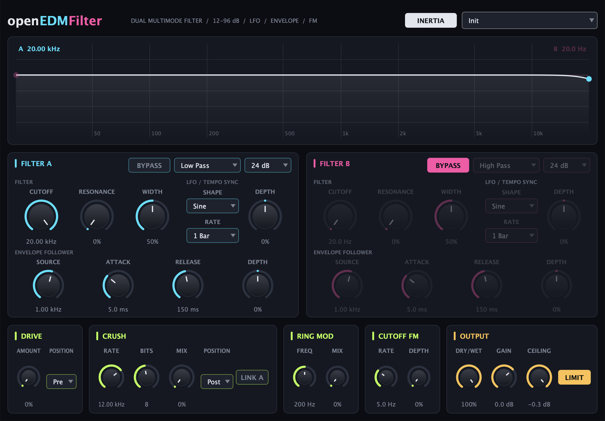

# openEDMFilter

A dual multimode filter plugin for EDM production. It covers the feature set of Vengeance Producer Suite Philta XL with a new UI. Builds VST3, AU, LV2 and Standalone for macOS, Windows and Linux.



## Features

- Two filters in series (A into B). Each one has low-pass, high-pass, band-pass and notch modes, 12, 24, 48 or 96 dB/oct slopes, resonance, and resonance width. Width also sets the band for band-pass and notch.
- Full bypass per filter. The BYPASS button crossfades over 10 ms so it does not click. A fully bypassed filter does no processing, and its curve leaves the display.
- Tempo-synced LFO per filter. Five shapes (sine, triangle, saw up, saw down, square), rates from 1/32 to 8 bars with triplets, and bipolar depth. While the host plays, the phase locks to the host transport, so the LFO lands on the same point of the bar on every pass.
- Envelope follower per filter. It has a source frequency (it listens to a band of the input), attack, release, and bipolar depth.
- Cutoff FM. A sine oscillator modulates both cutoffs, up to audio rate.
- Drive. tanh saturation, before or after the filters.
- Crush. A sample-rate reducer and bit crusher, before or after the filters. LINK A makes the crush rate follow filter A's cutoff modulation.
- Ring modulator with frequency and mix controls.
- Output section. Dry/wet, gain, and a stereo-linked peak limiter with a ceiling.
- Filter inertia. This smooths cutoff moves on 48 and 96 dB slopes to stop clicks. Turn it off for faster, harder gating.
- 18 factory presets, available from the preset menu and as host programs.
- Live response display. It shows both curves and the combined curve, and follows the LFO, envelope and FM in real time.
- All parameters can be automated in the host.

The original also ships VST2 and AAX. This build does not: Steinberg no longer licenses the VST2 SDK, and AAX needs Avid's SDK and signing.

## Build

You need CMake 3.22 or later and a C++20 compiler. CMake fetches JUCE and Catch2.

```sh
cmake -B build -DCMAKE_BUILD_TYPE=Release
cmake --build build --config Release --parallel
ctest --test-dir build --output-on-failure
```

The plugins are written to `build/OpenEDMFilter_artefacts/Release/`.

## CI

`.github/workflows/build.yml` builds and tests on macOS (universal binary), Windows and Linux on every push to `main`. It runs pluginval at strictness 5 on macOS and Windows, then uploads a zip for each OS. Push a `v*` tag to publish those zips as a GitHub release.

The macOS builds have an ad hoc signature only. On first use, run `xattr -dr com.apple.quarantine <plugin>` or allow the plugin in System Settings.

## Layout

- `Source/Core`: DSP with no JUCE dependency (filters, modulators, effects, and the engine that chains them). The unit tests cover this code.
- `Source/Plugin`: the JUCE processor, parameters, presets, and editor.
- `Tests`: Catch2 tests.
