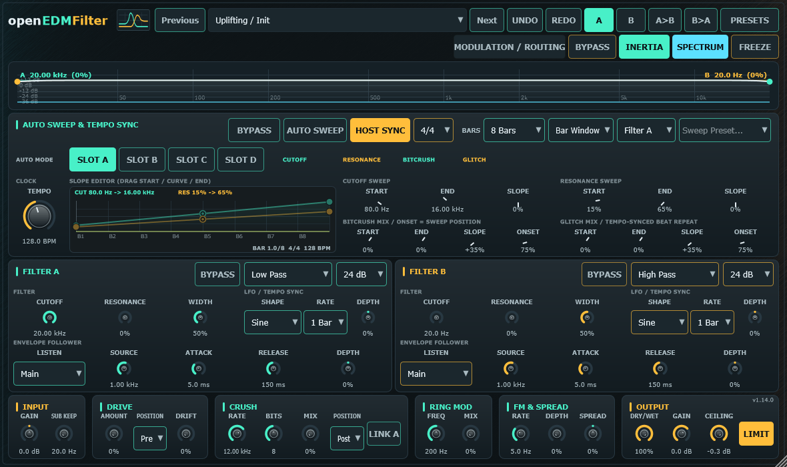

# openEDMFilter v1.13.0

A dual filter effect for shaping transitions, resonant builds, and moving sounds. Combine two filters, tempo-synced sweeps, and modulation.

[Install with OpenVST Manager](https://github.com/alanmarcero/alan-m-OpenVSTManager/releases/latest) · [Download v1.13.0](https://github.com/alanmarcero/openEDMFilter/releases/tag/v1.13.0)

## Beta

All of these plugins are in beta. The macOS and Linux builds are not up to date, so the Windows build is the one to use for now. A plugin can change dramatically from one release to the next, but the goal is for each one to keep getting better.

*Native editor capture. [See capture details](docs/SCREENSHOTS.md).*

## Features

- **Two filters:** Route Filter A and Filter B in series or parallel. Choose low-pass, high-pass, band-pass, notch, all-pass, low shelf, high shelf, or bell cut. Set slope from 12 to 96 dB per octave, resonance, and width. The response graph shows the individual filters and their combined response, including cancellation in parallel. A/B Blend sets the parallel balance. Each filter has its own bypass.
- **LFO and envelope:** Each filter has an LFO that moves its cutoff, an envelope follower that responds to input, and cutoff FM. LFOs offer sine, triangle, rising saw, falling saw, and square. Rates run from 1/32 note to 8 bars with triplets. Set bipolar depth. Choose the envelope source frequency, attack, release, and bipolar depth.
- **Cutoff FM:** Choose sine, triangle, rising saw, falling saw, or square. Set the rate up to audio rate. Choose Filter A, Filter B, or both filters as the destination.
- **Steps and MIDI:** Each filter has Off, Steps, or Euclidean mode. Steps mode has 16 bipolar values. Euclidean mode spaces pulses evenly. Set length, rotation, step rate from 1/16 note to 4 beats, pulse count, and bipolar depth. MIDI modulation can use velocity, aftertouch, or a selected CC.
- **Stereo modes:** Choose Linked, Left/Right, or Mid/Side processing. Set separate modulation depth, phase offset, and cutoff offset for the right or side lane.
- **Auto Sweep:** Save four independent slots, A through D. Set each slot to 1–64 bars and choose Filter A, Filter B, both filters, or mirrored filters. Modes include Bar Window, Every Bar, Up & Down, and Bar + Macro.
- **Sweep curves:** Shape cutoff and resonance with the graph or Start, End, and Slope controls. Set Start, End, Slope, and Onset for the bitcrush and glitch effects. Choose when each effect enters the sweep. Sweep bypass turns off automatic bitcrush and glitch sweeps. Manual Crush remains available.
- **Other effects:** Add Drive, Crush, and ring modulation before or after the filters. Set the ring modulator frequency and mix. Link Crush rate to Filter A modulation. Set input gain from −24 to +24 dB, dry/wet mix, output gain, and a stereo-linked peak limiter with an adjustable ceiling.
- **Meters and display:** View input and output peaks, filter response curves, and a live spectrum. Freeze or hide the spectrum. Drag the response marker to adjust cutoff and resonance.
- **Presets and sessions:** Choose from 96 factory presets and 32 sweep-curve presets organized across seven dance styles (24 Uplifting + 12 each in Rolling, Progressive, Psy, Tech, Bass & Breaks, and Classic; 8 Uplifting + 4 per style for sweep curves). Controls support host automation and session recall. Save, rename, and delete your own presets in Documents/Alan Marcero/openEDMFilter/Presets. The preset list searches factory and user presets and can mark favorites. Factory presets stay read-only.
- **Undo and A/B:** Undo and redo control edits with the header buttons or Ctrl/Cmd+Z and Shift+Ctrl/Cmd+Z. Slots A and B keep two full settings, and either slot can be copied onto the other.
- **Sidechain envelopes:** Each filter's envelope can listen to the main input or a sidechain from another track. If no sidechain is connected, that envelope keeps following the main input.
- **Resizable window:** Drag the editor to fit the screen. It stays readable below 800 pixels tall, the proportions are not locked, and the size is saved with the session.

HOST SYNC follows host tempo and time signature. The internal clock supports 40–240 BPM. Select 2/4, 3/4, 4/4, 5/4, 6/4, 6/8, 7/8, 9/8, or 12/8. The standalone app accepts MIDI and uses the internal clock. The plugin reports 110 samples of latency.

## Shape a transition

Choose **Low Shelf** to bring up the bass, **High Shelf** to lift the top, or **Bell Cut** to clear space around a frequency. Resonance sets shelving boost from +3 to +12 dB or bell-cut depth from −3 to −18 dB. Width controls the transition or bell bandwidth. The gain range holds at every slope. For a phaser sweep, select **All Pass** on Filter A, bypass B, then select Parallel and put A/B Blend halfway. Move A’s cutoff to move the cancellation through the spectrum.

The animated pair of filter curves beside the title pulses with the host transport. It follows tempo and seeks, rests when the host stops, and follows the internal clock in Standalone.

The original four positions on the **A Type** and **B Type** automation lanes keep their normalized values. **A Response** and **B Response** select the new modes. Choose **Original Type** on that lane to follow the original type automation again. The native Type menu manages both lanes. Earlier projects and factory presets start in Original Type.

## Install and compatibility

The v1.13.0 release includes VST3, AU, LV2, and standalone packages for macOS, Windows, and Linux. The macOS package supports Apple Silicon and Intel. The Windows and Linux packages are x64.

| Platform | Formats |
| --- | --- |
| macOS | VST3, AU, LV2, Standalone |
| Windows, x64 | VST3, LV2, Standalone |
| Linux, x64 | VST3, LV2, Standalone |

OpenVST Manager installs VST3 and AU. Install LV2 and the standalone app from the [release packages](https://github.com/alanmarcero/openEDMFilter/releases/tag/v1.13.0). Rescan your host after installation. Some hosts may ask you to select the plugin again in older AU sessions. The macOS AU now accepts MIDI. Route a sidechain in the host when an envelope should follow another track.

## License

openEDMFilter uses the MIT license. See [LICENSE](LICENSE).
