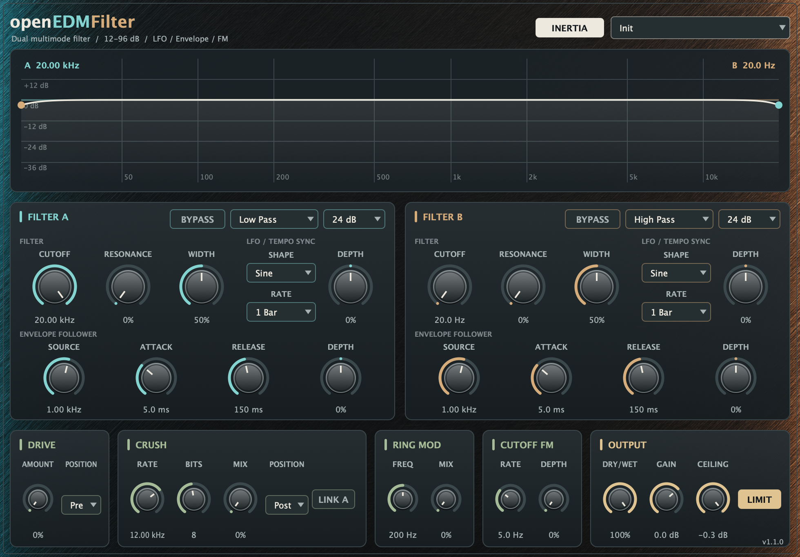

# Native UI screenshot

`assets/native-ui.png` was captured on macOS on 2026-10-27 from the actual **v1.1.0 VST3 editor**, loaded in a JUCE 8.0.9 host. It shows the plugin's default state while processing a stereo test signal at 48 kHz with a 120 BPM host transport. The host renders the native AppKit view into a PNG at the display's backing resolution (1960 × 1368). Controls, labels, meters and version text come from the running plugin.

- [Release v1.1.0](https://github.com/alanmarcero/openEDMFilter/releases/tag/v1.1.0)
- Source commit: [`fee7b7b`](https://github.com/alanmarcero/openEDMFilter/commit/fee7b7b354cfc8fac3d67a435e4b2ce8ed908ef6)
- Release asset: `openEDMFilter-macOS.zip`
- Archive SHA-256, verified before capture: `d56f4041986c1c1c7aa46995bea3b4c78de609f36e7b34f89d642b11e7f62c2a`
- Screenshot SHA-256: `04c59dc61590d254a1a87ea1604674a0b5e287b5ec4c491272541079b88313ff`
