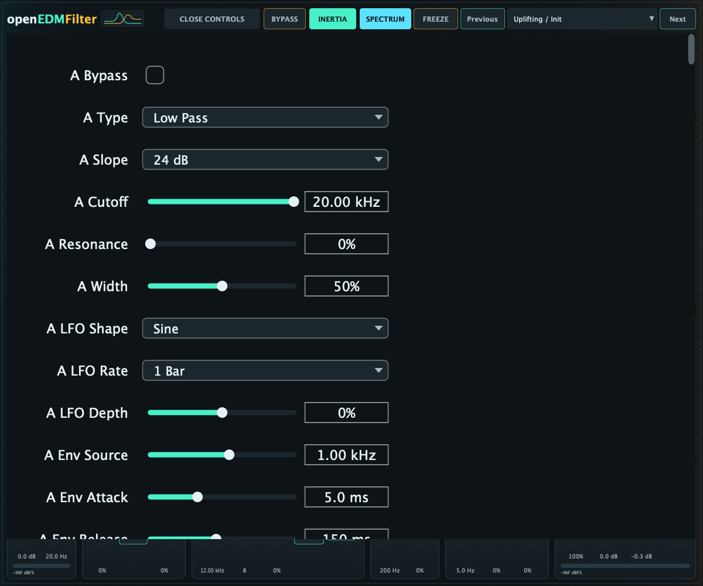

# Native UI screenshot


`assets/native-ui.png` is the v1.10.0 editor at 1200 x 1000, captured from the Release build on 2026-11-17. The response graph shows a live multitone spectrum; the Input Gain is +3 dB and both peak meters are active. The A and B menus select Low Shelf and Bell Cut. The title contains a beat-synced response SVG. Neon Staircase curves, Auto Mode D, BARS set to 1 Bar, playhead at 90% of that bar. The Auto Mode slots have full labels, and the capture shows all panels without clipping. It is a component render of the editor.



Reproduce on macOS from the repository root:

```sh
cmake --build build --target openedm_plugin_tests --parallel
OEF_CAPTURE="$PWD/assets/native-ui.png" build/openedm_plugin_tests '[ui]'
```

The capture test also exercises A/B/C/D button selection, host-driven selection, editing the selected slot, and changing slots during a knob drag without corrupting automation gestures. For the screenshot, it renders a multitone signal so the spectrum and level meters show live values.


## OpenVST Manager preview

OpenVST Manager shows `docs/screenshots/preview.png` from `main` (see `screenshotPath` in its catalog), and the GitHub release body and README hero point at the same file. This is the single image to keep current. Refresh it with the main editor capture whenever the UI changes, and commit it before tagging a release:

```sh
OEF_CAPTURE="$PWD/docs/screenshots/preview.png" build/openedm_plugin_tests '[ui]'
```
