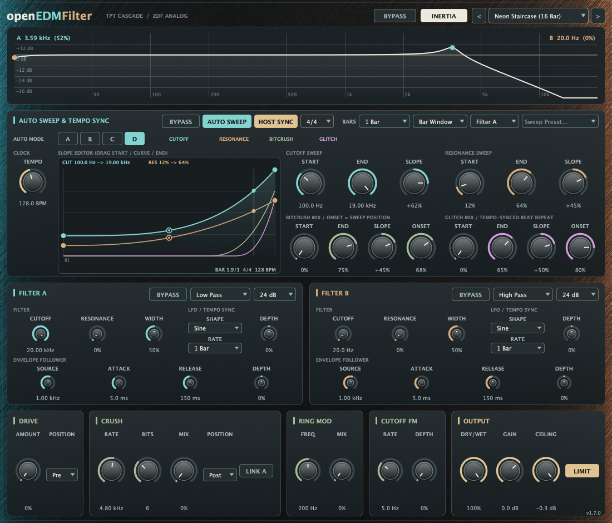

# Native UI screenshot



`assets/native-ui.png` is the v1.4.0 editor at 1100 x 940, captured from the release build on 2026-11-06. Neon Staircase curves, Auto Mode D, BARS set to 1 Bar, playhead at 90% of that bar. It is a component render of the editor.

Reproduce on macOS from the repository root:

```sh
cmake --build build --target openedm_plugin_tests --parallel
OEF_CAPTURE="$PWD/assets/native-ui.png" build/openedm_plugin_tests '[ui]'
```

The capture test also exercises A/B/C/D button selection, host-driven selection, editing the selected slot, and changing slots during a knob drag without corrupting automation gestures.
